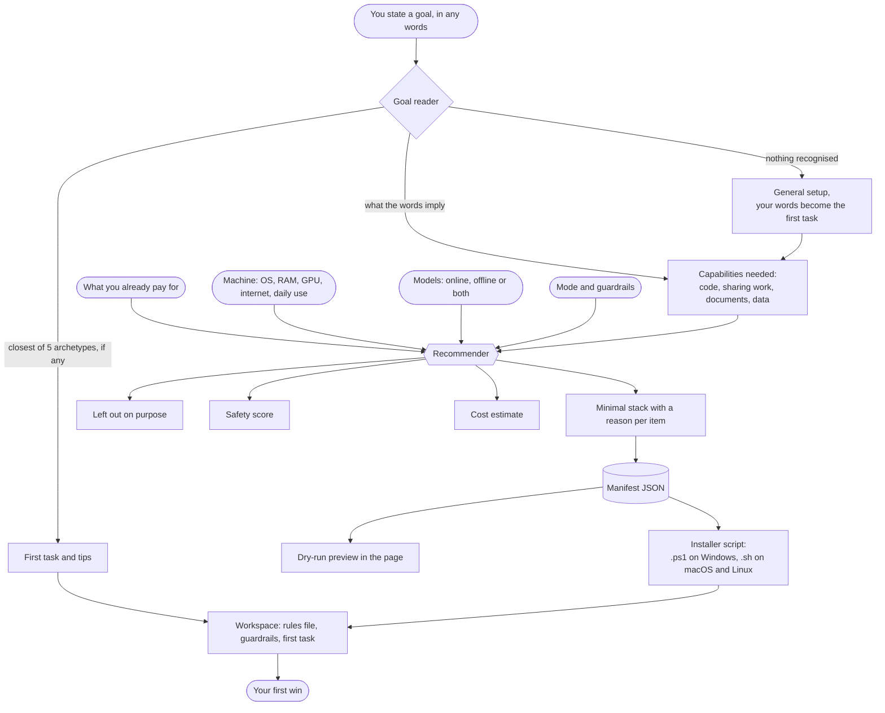
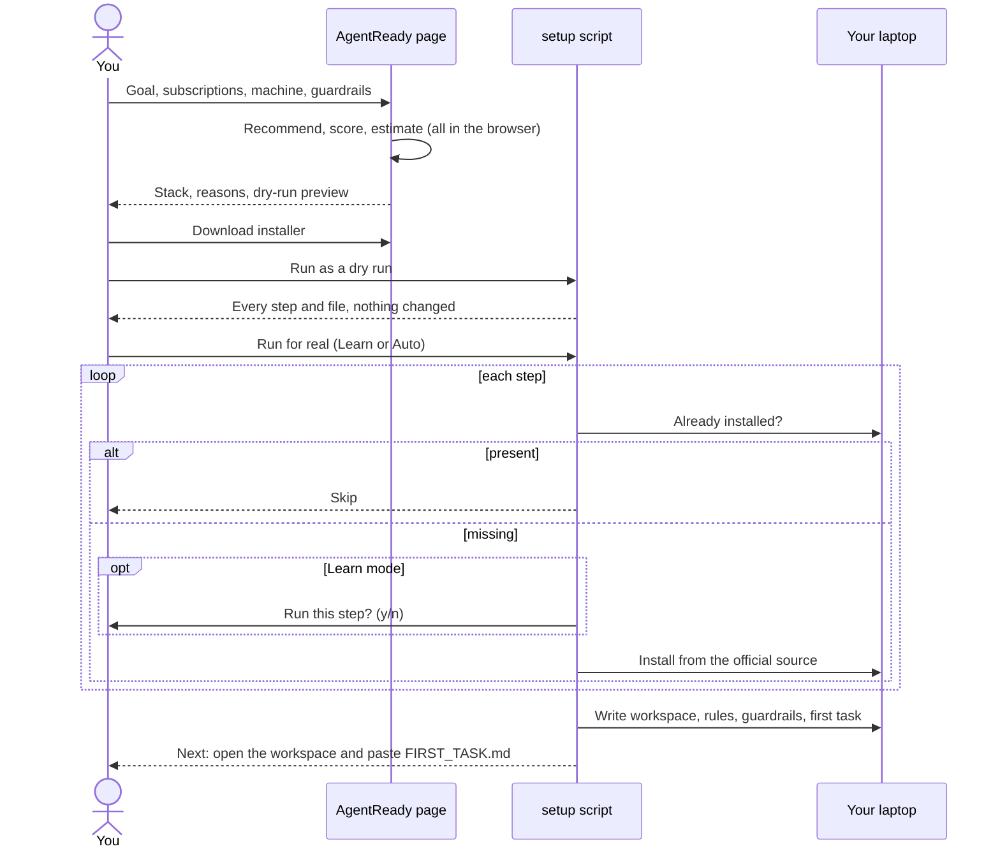
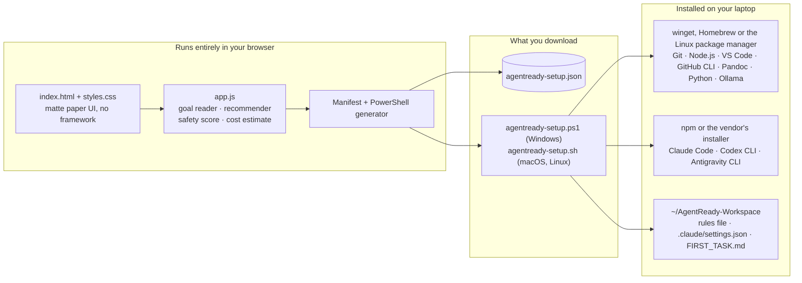
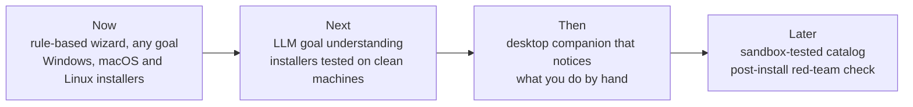

<div align="center">

# AgentReady

### Why is setting up AI harder than *using* it?

**Tell it your goal. It looks at your laptop and your budget, then builds the smallest safe AI agent setup that gets you there, in one script you can read before you run.**


</div>

---

## The problem

Powerful AI agents exist. Most people still can't use them, because the hard part comes *before* the first prompt.

| The itch | Who it hurts |
|---|---|
| Why do I need to know what an MCP server is before I can get help with homework? | Students, first-timers |
| Why can't I tell which AI tool my existing subscription already covers? | Anyone paying for AI |
| Why does every setup guide assume 32 GB of RAM and fast Wi-Fi? | Budget laptops, small towns |
| Why does an agent get the run of my files by default? | Everyone |
| Why is every tutorial out of date within a month? | Self-learners |
| Why am I staring at an empty prompt after installing? | Teachers, non-coders |

**Our problem statement:** close the gap between a normal person and using AI agents for jobs, projects, assignments and internships.

## What AgentReady does

- **Goal first, in any words.** You say *"land a backend internship"*, *"grade 60 papers by Friday"* or *"keep my shop's accounts in a spreadsheet"*, not which tool you want. Nothing is rejected: a goal it does not recognise still gets a general setup built around your exact words.
- **Fits your machine and wallet.** It uses the subscription you already have, and asks about RAM and graphics card so a local model is sized to what the laptop can carry.
- **Online, offline or both.** You choose rented online models, a model on your own machine, or an online agent with an offline backup. "Decide for me" adds a local model only when your internet or free tier can't carry you.
- **Minimum stack.** Every item comes with a reason. It also lists what it left out, and why.
- **Safe by default.** Guardrail rules, a dry run and a safety score before anything touches your laptop.
- **A first win.** A ready-to-paste first task for your goal, so you never face an empty prompt, plus three tips for what to ask next.

## How it works



## How the stack gets picked

The recommender is a small set of readable rules. No black box.

```mermaid
flowchart TD
    Q1{Paying for Claude?} -->|yes| CC[Claude Code]
    Q1 -->|no| Q2{Paying for ChatGPT?}
    Q2 -->|yes| CX[Codex CLI]
    Q2 -->|no| GM[Antigravity CLI on the free tier]

    CC & CX & GM --> Q3{Local model wanted?<br/>You chose offline or both, or on "decide for me":<br/>patchy internet, or heavy use on a free tier}
    Q3 -->|no| NL[Skip the local model: dead weight]
    Q3 -->|yes| Q4{RAM and graphics card}
    Q4 -->|4 GB RAM or less| SK[Skip: it would freeze the laptop]
    Q4 -->|8 GB RAM| L1[Ollama + 1.5b model<br/>3b with a 4 GB card]
    Q4 -->|16 GB RAM, or an 8 GB card| L2[Ollama + 7b model]
    Q4 -->|32 GB RAM, or 16 GB RAM with a 12 GB card| L3[Ollama + 14b model]

    NL & SK & L1 & L2 & L3 --> Q5{Terminal comfort}
    Q5 -->|new or some| VS[Add VS Code]
    Q5 -->|pro| NV[Keep your own editor]

    VS & NV --> Q6{What the goal's words imply}
    Q6 -->|code| T1[Git]
    Q6 -->|sharing work, dev work| T2[Git + GitHub CLI]
    Q6 -->|documents| T3[Pandoc]
    Q6 -->|data| T4[Python]
    Q6 -->|nothing recognised| T5[Git, as an undo net]
```

"Offline" is a chat-only setup: Ollama and a model, with no agent, because small local models are not yet reliable at running tools.

## What the installer does

The page gives you the script for your system: `agentready-setup.ps1` on Windows, and one `agentready-setup.sh` that works on both macOS (Homebrew) and Linux (apt, dnf, pacman or zypper, found when it runs). The flow is the same on all three.



## Tech stack



| Layer | Choice | Why |
|---|---|---|
| UI | HTML, CSS, vanilla JS | No build step. Open the file and it works, even offline |
| Look | Flat matte surfaces with an inline SVG paper grain over a soft colour field | No images or fonts to download; cheap to paint on a budget laptop |
| Motion | CSS transitions on `transform` and `opacity`, one `IntersectionObserver` | Stays smooth on weak hardware; reduced-motion keeps the fades and drops the movement |
| Logic | Plain rule functions in `app.js` | Easy to read, easy to test in Node |
| Installer | Generated PowerShell (Windows) and plain shell (macOS, Linux) | Nothing to trust but a script you can read. The shell script needs no jq or Python |
| Packages | winget, Homebrew, apt / dnf / pacman / zypper, vendor installers and npm packages | Official sources only |
| Free agent | Antigravity CLI (`agy`) | Gemini CLI stopped serving free personal accounts on 18 June 2026 |
| Local AI | Ollama, model sized to RAM and graphics memory | Keeps low-spec and offline users working |

## Safety score

| Check | Points |
|---|---|
| Every tool comes from its official source | 20 |
| The agent works in its own folder | 15 |
| Destructive commands blocked | 20 |
| Secret files off limits | 20 |
| You approve each step (Learn mode) | 10 |
| Rules enforced by the agent's permission system | 10 |
| No community add-ons | 5 |

This is a check of the chosen settings, not a penetration test.

## Try it

```bash
git clone https://github.com/Arnav-dll/AgentReady.git
cd AgentReady
# open index.html in a browser. That's it.
```

After the wizard, from the folder where the script downloaded:

```powershell
# See every step. Changes nothing.
powershell -ExecutionPolicy Bypass -File .\agentready-setup.ps1 -DryRun

# Install, asking before each step
powershell -ExecutionPolicy Bypass -File .\agentready-setup.ps1 -Learn

# Install everything
powershell -ExecutionPolicy Bypass -File .\agentready-setup.ps1 -Auto
```

On macOS or Linux:

```bash
bash agentready-setup.sh --dry-run   # see every step, changes nothing
bash agentready-setup.sh --learn     # ask before each step
bash agentready-setup.sh --auto      # install everything
```

Tools that are already installed are skipped, and existing workspace files are never overwritten. If `winget` is not recognised on a Windows machine, the script re-registers App Installer first, and stops with instructions if that does not work.

## Project layout

```text
AgentReady/
├── index.html      # landing page and wizard
├── styles.css      # matte paper design system and motion
├── app.js          # goal reader, recommender, scoring, script generator
└── docs/
    └── hero.png
```

## Honest limits

- The goal reader and recommender are **rule-based**, not an ML model. Any goal is accepted, but the reader only recognises English keywords: a goal in another language, or one outside code, documents and data, gets the general setup with your words passed to the agent.
- The macOS and Linux script has **never run on a real Mac or Linux machine**. It was checked on Windows in Git Bash with the system faked: syntax, dry runs, and a real run against stub commands. Linux covers apt, dnf, pacman and zypper only, and VS Code on Linux needs snap.
- **Offline mode is chat-only.** No agent is installed, so the model cannot create files or run tools.
- The local model is always a Qwen coder model, also for goals that are not about code.
- The cost figure is a **rough estimate**. Provider limits change.
- The community skill pack step is **untested end to end**, and no full install has been run on a clean machine: the Windows script has only been verified with `-DryRun`, and the winget repair only as a simulated dry run.

## Roadmap



## Team

| | Role |
|---|---|
| [@Arnav-dll](https://github.com/Arnav-dll) | Creator and repo owner |
| [@DhruvJoshi-GIT](https://github.com/DhruvJoshi-GIT) | Collaborator |

## License

[MIT](LICENSE)

## Credits

Built for the IIIT hackathon open track.
