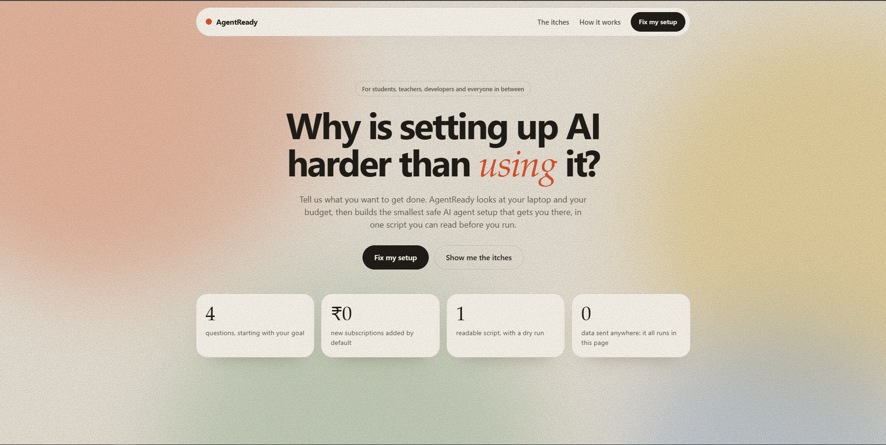
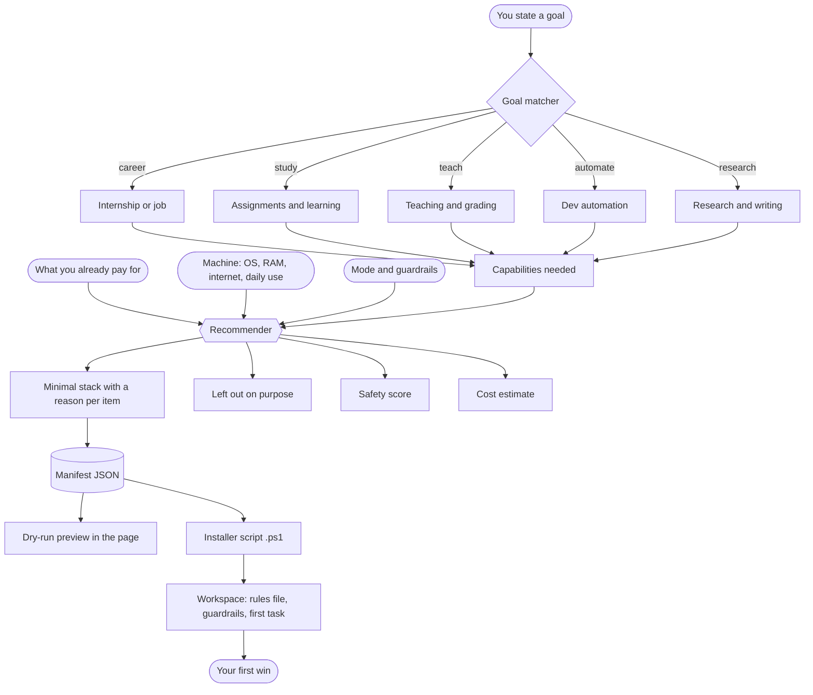
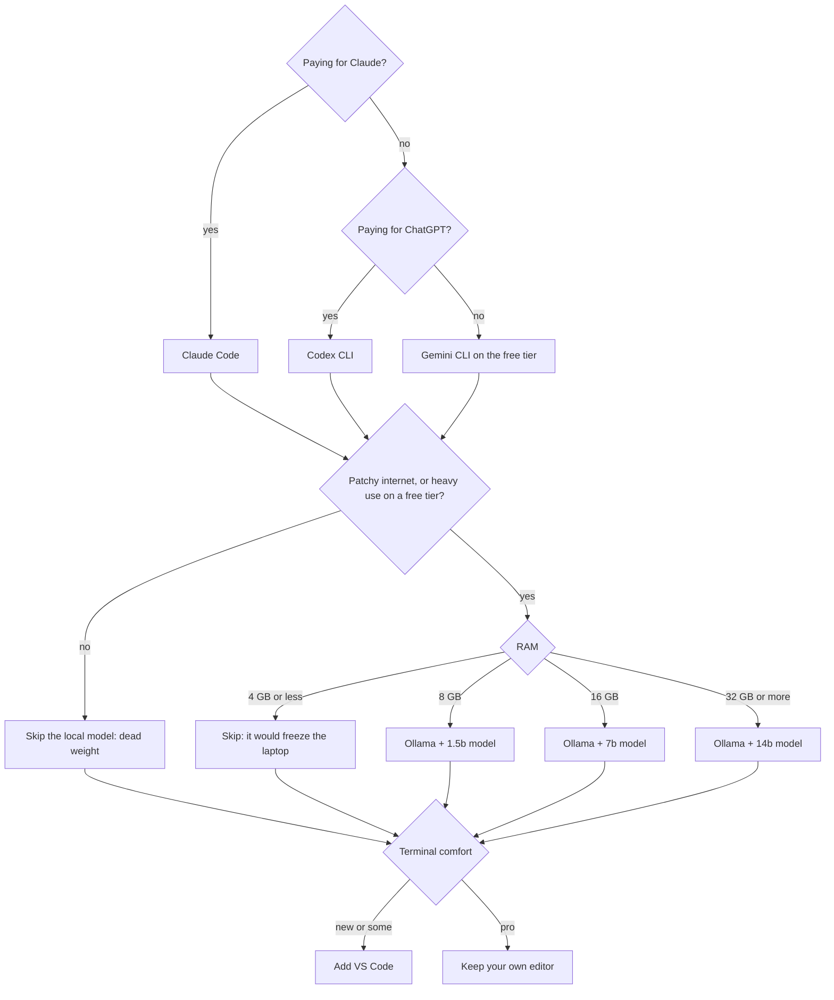
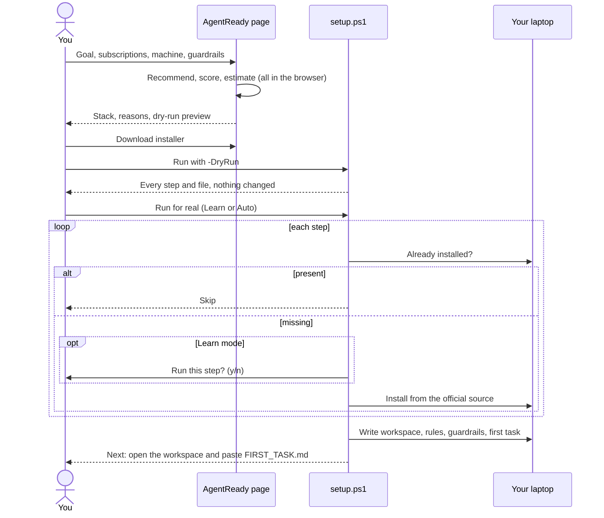
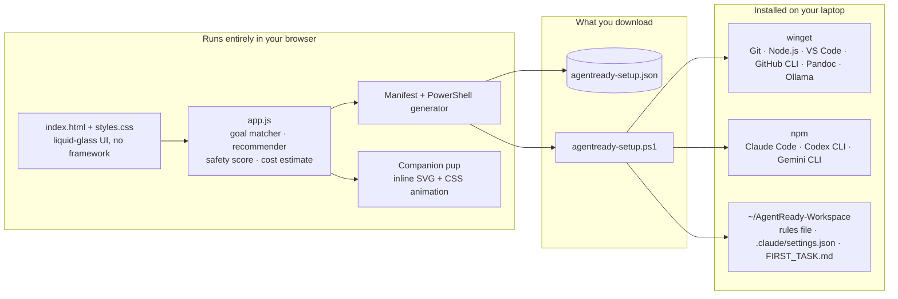
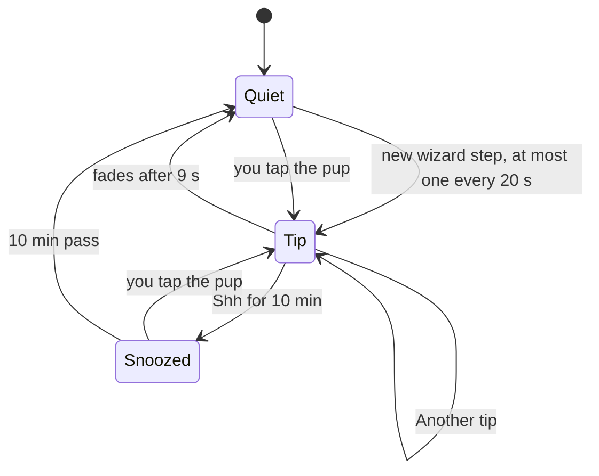
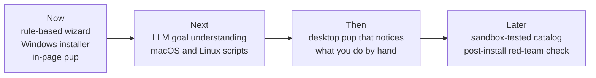

<div align="center">

# 🐶 AgentReady

### Why is setting up AI harder than *using* it?

**Tell it your goal. It looks at your laptop and your budget, then builds the smallest safe AI agent setup that gets you there, in one script you can read before you run.**




</div>

---

## The problem

Powerful AI agents exist. Most people still can't use them, because the hard part comes *before* the first prompt.

| The itch | Who it hurts |
|---|---|
| Why do I need to know what an MCP server is before I can get help with homework? | Students, first-timers |
| Why can't I tell which AI tool my existing subscription already covers? | Anyone paying for AI |
| Why does every setup guide assume 32 GB of RAM and fast Wi-Fi? | Budget laptops, small towns |
| Why does an agent get the run of my files by default? | Everyone |
| Why is every tutorial out of date within a month? | Self-learners |
| Why am I staring at an empty prompt after installing? | Teachers, non-coders |

**Our problem statement:** close the gap between a normal person and using AI agents for jobs, projects, assignments and internships.

## What AgentReady does

- **Goal first.** You say *"land a backend internship"* or *"grade 60 papers by Friday"*, not which tool you want.
- **Fits your machine and wallet.** It uses the subscription you already have, and adds a small local model only when your internet or free tier can't carry you.
- **Minimum stack.** Every item comes with a reason. It also lists what it left out, and why.
- **Safe by default.** Guardrail rules, a dry run and a safety score before anything touches your laptop.
- **A first win.** A ready-to-paste first task for your goal, so you never face an empty prompt.
- **A pup, not a popup.** A small companion in the corner gives one tip at a time, fades on its own, and can be told to shh.

## How it works



## How the stack gets picked

The recommender is a small set of readable rules. No black box.



## What the installer does



## Tech stack



| Layer | Choice | Why |
|---|---|---|
| UI | HTML, CSS, vanilla JS | No build step. Open the file and it works, even offline |
| Look | `backdrop-filter` glass over a soft colour field | Apple-style liquid glass, with a reduced-motion fallback |
| Logic | Plain rule functions in `app.js` | Easy to read, easy to test in Node |
| Installer | Generated PowerShell | Nothing to trust but a script you can read |
| Packages | winget and vendor npm packages | Official sources only |
| Local AI | Ollama, model sized to RAM | Keeps low-spec and offline users working |

## The pup



It never opens a modal, never takes focus, and only the pup itself accepts clicks.

## Safety score

| Check | Points |
|---|---|
| Every tool comes from its official source | 20 |
| The agent works in its own folder | 15 |
| Destructive commands blocked | 20 |
| Secret files off limits | 20 |
| You approve each step (Learn mode) | 10 |
| Rules enforced by the agent's permission system | 10 |
| No community add-ons | 5 |

This is a check of the chosen settings, not a penetration test.

## Try it

```bash
git clone https://github.com/Arnav-dll/AgentReady.git
cd AgentReady
# open index.html in a browser. That's it.
```

After the wizard, from the folder where the script downloaded:

```powershell
# See every step. Changes nothing.
powershell -ExecutionPolicy Bypass -File .\agentready-setup.ps1 -DryRun

# Install, asking before each step
powershell -ExecutionPolicy Bypass -File .\agentready-setup.ps1 -Learn

# Install everything
powershell -ExecutionPolicy Bypass -File .\agentready-setup.ps1 -Auto
```

Tools that are already installed are skipped, and existing workspace files are never overwritten.

## Project layout

```text
AgentReady/
├── index.html      # landing page, wizard and pup markup
├── styles.css      # liquid-glass design system
├── app.js          # goals, recommender, scoring, script generator, pup
└── docs/
    └── hero.png
```

## Honest limits

- The goal matcher and recommender are **rule-based**, not an ML model.
- The installer script is **Windows only**. macOS and Linux users get the manifest as a checklist.
- The pup lives **inside the page**. A desktop companion is on the roadmap.
- The cost figure is a **rough estimate**. Provider limits change.
- The community skill pack step is **untested end to end**.

## Roadmap



## Team

| | Role |
|---|---|
| [@Arnav-dll](https://github.com/Arnav-dll) | Creator and repo owner |
| [@DhruvJoshi-GIT](https://github.com/DhruvJoshi-GIT) | Collaborator |

## License

[MIT](LICENSE)

## Credits

Built for the IIIT hackathon open track.
